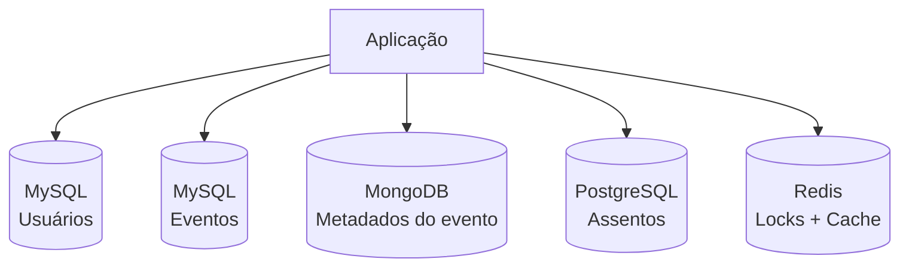

# 🎟️ Catálogo de Eventos e Reserva de Assentos

Sistema para **catálogo de eventos**, **gerenciamento de usuários** e **escolha de assentos**, construído com uma arquitetura de **persistência poliglota**: cada tipo de dado vive no banco que melhor atende às suas necessidades.

> 🚧 Projeto em desenvolvimento.

---

## 📌 Sobre o projeto

A ideia é oferecer uma plataforma onde:

- usuários se cadastram e gerenciam suas contas;
- eventos são cadastrados e exibidos em uma vitrine (showcase);
- usuários escolhem assentos para um evento, sem risco de dois usuários reservarem o mesmo lugar ao mesmo tempo.

O foco do projeto é explorar **quando e por que usar cada tecnologia de dados**, combinando bancos relacionais, NoSQL e Redis em uma mesma aplicação.

---

## 🧠 Decisões de arquitetura

| Domínio | Tecnologia | Por quê? |
|---|---|---|
| **Usuários** | MySQL | Exige mais integridade e controle. Tabelas bem definidas, com relacionamentos e constraints. |
| **Eventos** (dados estruturados) | MySQL (instância separada) | Dados bem estruturados, com definições claras. Instância própria para isolar o domínio. |
| **Eventos** (metadados) | MongoDB | Metadados variam de evento para evento. O modelo flexível de documentos evita migrações constantes. |
| **Assentos** | PostgreSQL | Todo o domínio de assentos (mapa, status, reservas) fica em um banco dedicado. |
| **Travas (locks)** | Redis | Controle de concorrência na escolha de assentos. |
| **Cache** | Redis | Acelera a consulta da vitrine com todos os eventos cadastrados. |

### Visão geral



### 🔒 Redis como mecanismo de travas

Quando vários usuários tentam escolher o mesmo assento ao mesmo tempo, o Redis atua como mecanismo de lock: apenas uma requisição por vez consegue "segurar" aquele assento enquanto a reserva é processada. Isso evita **reservas duplicadas** (*double booking*).

### ⚡ Redis como cache

A vitrine de eventos é uma consulta frequente. Os resultados ficam em cache no Redis, reduzindo a carga nos bancos e acelerando a resposta.

---

## ✨ Funcionalidades

- [ ] Cadastro e gerenciamento de usuários
- [ ] Catálogo de eventos (vitrine com todos os eventos cadastrados)
- [ ] Metadados flexíveis por evento
- [ ] Escolha e reserva de assentos
- [ ] Controle de concorrência na reserva (locks)
- [ ] Cache da listagem de eventos

---

## 🛠️ Tecnologias

**Bancos de dados**


**Aplicação**


Persistência com **Spring Data**, usando um módulo para cada tipo de banco:

| Módulo | Usado em |
|---|---|
| Spring Data JPA | MySQL (usuários), MySQL (eventos) e PostgreSQL (assentos) |
| Spring Data MongoDB | Metadados dos eventos |
| Spring Data Redis | Locks de assentos e cache da vitrine |

> Como o projeto tem **três bancos relacionais** (dois MySQL e um PostgreSQL), cada um precisa do seu próprio `DataSource`, `EntityManagerFactory` e `TransactionManager`, com repositórios separados por pacote.

---

## 🚀 Como rodar

> Esta seção será preenchida conforme o projeto evoluir.

### Pré-requisitos

- Git
- JDK 25 (LTS)
- Docker e Docker Compose (sugerido para subir os bancos localmente)

> Não é necessário instalar o Gradle: o projeto usa o Gradle Wrapper (`./gradlew`).

### Passo a passo

```bash
# 1. Clone o repositório
git clone https://github.com/<seu-usuario>/<nome-do-repositorio>.git
cd <nome-do-repositorio>

# 2. Suba os bancos de dados
docker compose up -d

# 3. Execute a aplicação
./gradlew bootRun

# Para rodar os testes
./gradlew test
```

---

## 📂 Estrutura do projeto

```
.
├── docs/            # Documentação e diagramas
├── src/             # Código-fonte da aplicação
├── build.gradle     # Dependências e configuração do build (Groovy DSL)
├── settings.gradle
├── docker-compose.yml
└── README.md
```

> A estrutura pode mudar conforme o desenvolvimento.

---

## 🗺️ Roadmap

- [ ] Modelagem dos bancos (usuários, eventos e assentos)
- [ ] Ambiente com Docker Compose
- [ ] CRUD de usuários
- [ ] CRUD de eventos e metadados
- [ ] Mapa e reserva de assentos
- [ ] Locks com Redis
- [ ] Cache da vitrine
- [ ] Testes automatizados
- [ ] Documentação da API

---

## 👤 Autor

**João Guilherme Santana de Oliveira**

[](https://github.com/JoaoGSantana10)
[](https://linkedin.com/in/joão-guilherme-santana-de-oliveira-a73472416)

---

## 📄 Licença

Este projeto está sob a licença [MIT](LICENSE). Consulte o arquivo `LICENSE` para mais detalhes.
